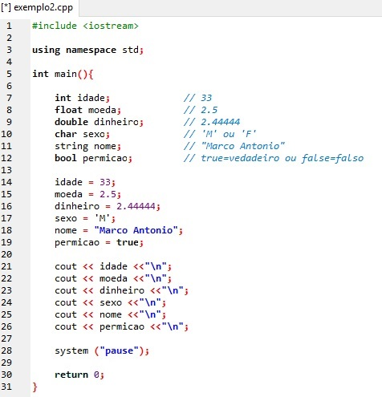

# 1. Variáveis (Gerenciamento de Estado)

Abstratamente, uma variável é um rótulo simbólico que aponta para um endereço na memória física do computador onde um valor está armazenado.



Para entender variáveis profundamente, precisamos dominar dois conceitos relacionados:

* **Tipagem (Estática vs. Dinâmica):** Em linguagens de tipagem estática (como C), o tamanho e o formato da memória (inteiro, decimal, caractere) são definidos na compilação e não mudam. Em linguagens de tipagem dinâmica (Python e JavaScript), o interpretador descobre o tipo em tempo de execução e a mesma variável pode apontar para um número agora e para um texto depois.

* **Escopo e Ciclo de Vida:** Define onde a variável "existe". Em C e JS (com `let`/`const`), o escopo é baseado em blocos `{}`. Em Python, o escopo é delimitado por funções ou módulos.

### Exemplo 1: Engenharia (Física/Elétrica) - Implementado em C

Na engenharia, variáveis frequentemente representam grandezas físicas lidas de sensores, onde o rigor com o tamanho da memória e a precisão do dado é crítico (sistemas embarcados).

```c
// C exige a declaração do tipo (float) e a quantidade de memória é fixa.
float tensao_sensor_v = 3.3;
float limiar_operacao = 5.0;

// O compilador garante que não tentaremos colocar um texto aqui acidentalmente.

```

### Exemplo 2: Ciência da Computação - Implementado em JavaScript

Na ciência da computação, variáveis frequentemente guardam estruturas de dados complexas ou referências em memória, como caches ou sessões ativas, onde a flexibilidade é mais vantajosa que o controle rigoroso de hardware.

```javascript
// JS (dinâmico) usa 'let' ou 'const'. O tipo é inferido em tempo de execução.
const maxConexoes = 100; // Valor primitivo (imutável)
let sessaoAtiva = {
    usuarioId: 4021,
    token: "abc123xyz"
}; // Objeto dinâmico na memória heap

```
